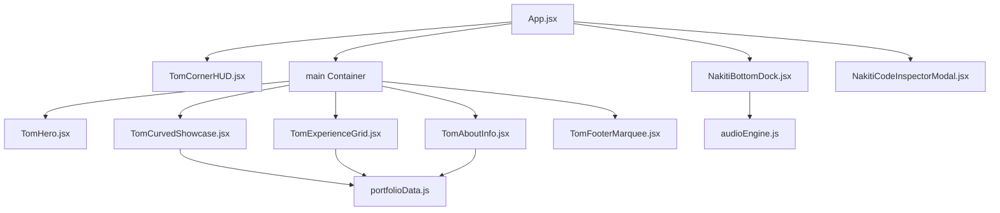

# System Architecture & Component Structure

This document outlines the architecture, data flow, component hierarchy, and design patterns used across Girindra Mohan's portfolio.

---

## 1. High-Level Architecture

The project is built as a single-page application (SPA) with React 18, bundled with Vite, and styled with Tailwind CSS. It features a standalone sub-page (`resume.html`) for clean, printable resume presentation.

---

## 2. Component Directory (`src/components/`)

### Active Production Components (`App.jsx`)
- **`TomCornerHUD.jsx`**: Floating corner headers.
  - Left: Minimal typography monogram (`g.`).
  - Right: `MENU` button featuring the signature 4-red-dots diamond icon with spinning/pulse animation, opening a full-screen or slide-out navigation overlay.
- **`TomHero.jsx`**: Context bar with real-time location/status indicator, followed by 3 stacked kinetic running marquees (`GIRINDRA / MOHAN / .WORK`) with vermillion accents.
- **`TomAboutInfo.jsx`**: 2-column editorial summary, philosophy, core competencies, and high-impact metrics.
- **`TomCurvedShowcase.jsx`**: Retro-futuristic curved glass terminal monitor with interactive project switcher, live metrics, tech badges, and direct links.
- **`TomExperienceGrid.jsx`**: Chronological work and leadership history with expandable detail cards, dates, and technology tags.
- **`TomFooterMarquee.jsx`**: 3D extruded monogram, interactive social links grid, contact CTA, and giant running marquee.
- **`NakitiBottomDock.jsx`**: Glassmorphic floating bottom bar containing:
  - **Sound Bar**: 5-bar / 5-dot sound toggle with live equalizer wave.
  - **Track Selector**: Dropdown to toggle between `Pulse` (Synth Rhythm) and `Drift` (Ambient Pad).
  - **Runtime HUD**: Button to open telemetry modal.
  - **Resume**: Direct link to `resume.html`.
  - **Scroll-to-Top**: Smooth scroll button.
- **`NakitiCodeInspectorModal.jsx`**: Developer telemetry displaying live FPS counter, memory allocation metrics, Web Audio node state, and system vitals.

---

## 3. Data & State Management

- **Centralized Data (`src/data/portfolioData.js`)**:
  All content including personal bio, featured projects, career timeline, education, and social URLs are maintained here.
- **Audio Engine (`src/utils/audioEngine.js`)**:
  Zero-asset procedural Web Audio synthesizer. Uses `AudioContext`, custom oscillators (`sawtooth`, `sine`), biquad lowpass filters, and LFO modulation to create continuous ambient generative soundscapes without requiring MP3 or WAV downloads.

---

## 4. Build & Deployment Pipeline

- **Build Tool**: Vite (`vite build`) outputting static assets to `./dist`.
- **CI/CD (`.github/workflows/deploy.yml`)**:
  1. `build` job: checks out repo, installs dependencies via `npm ci`, builds production bundles via `npm run build`, and stages pages artifact with `actions/upload-pages-artifact@v3`.
  2. `deploy` job (`needs: build`): deploys artifact to GitHub Pages via `actions/deploy-pages@v4`.
